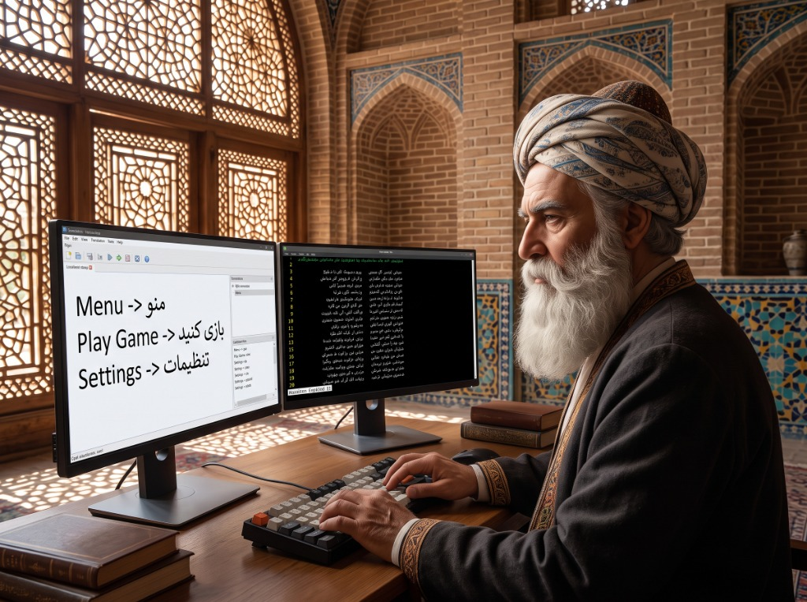

# ParsiSaz | پارسی‌ساز

**Preserving and standardizing the Persian language in modern gaming and computing.**  
*پاسداری، نوآوری و استانداردسازی زبان و خط پارسی در بازی‌ها و فناوری دیجیتال*

 

 

## 🌟 Overview

**ParsiSaz** is an open engineering initiative dedicated to Persian (Farsi) game localizations, reverse-engineering non-Unicode graphics engines, implementing Right-to-Left (RTL) text shaping, and developing modern translation toolchains.

Directed by **[Danial Pahlavan (@DanialPahlavan)](https://github.com/DanialPahlavan)**, the initiative maintains original translation assets, custom typography font atlases, and community localization patches for PC titles.

---

## 🚀 Interactive Portal

All live catalogs, reverse-engineering notes, and installation guides are hosted on our interactive portal:

👉 **[https://parsisaz.github.io/parsisaz/](https://parsisaz.github.io/parsisaz/)**

- 🎮 **73+ Localized & Upcoming Games**: Filter across *Official Releases*, *Open-Source Games*, and *Community Mods* (Free & Paid).
- 📱 **42+ Applications**: Search open-source software with Persian translation support.
- ⚠️ **Engine Challenges**: In-depth breakdowns of RTL text shaping, font injection, and game-specific quirks.
- 📋 **One-Click Install Guides**: Copyable directory paths and step-by-step instructions.

---

## 📚 Documentation & Ecosystem

- 🎮 **[Game Catalog & Status](./docs/CATALOG.md)**: Full list of repository patches, formats, and releases.
- ⚙️ **[Architecture & Toolchains](./docs/ARCHITECTURE.md)**: Details on `Parsik`, `farsiSaz`, and RTL font engines.
- ⚖️ **[Legal & Modding Policy](./docs/POLICY.md)**: Compliance, non-infringement standards, and copyright ethics.

---

  Founded & Maintained by <a href="https://github.com/DanialPahlavan">Danial Pahlavan</a>. All game trademarks belong to their respective publishers.

